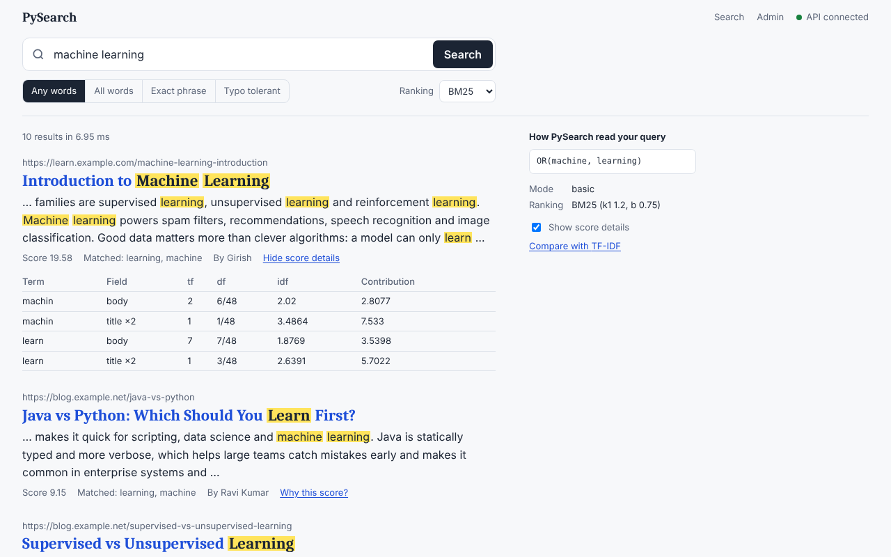
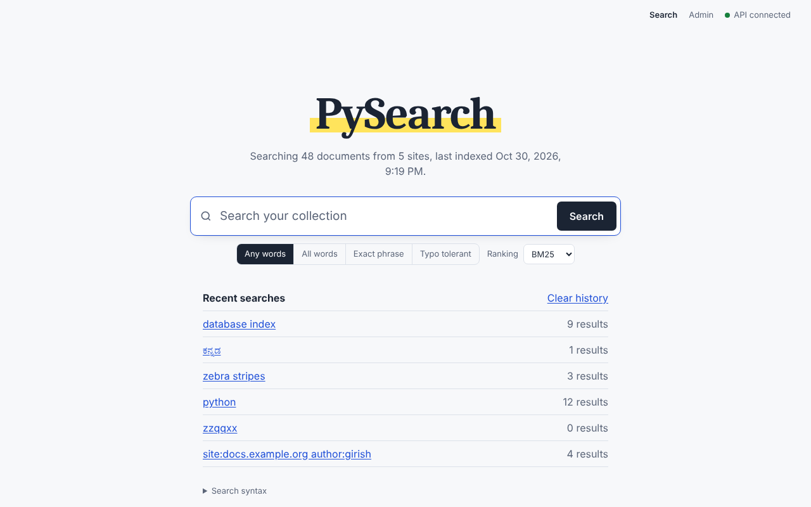
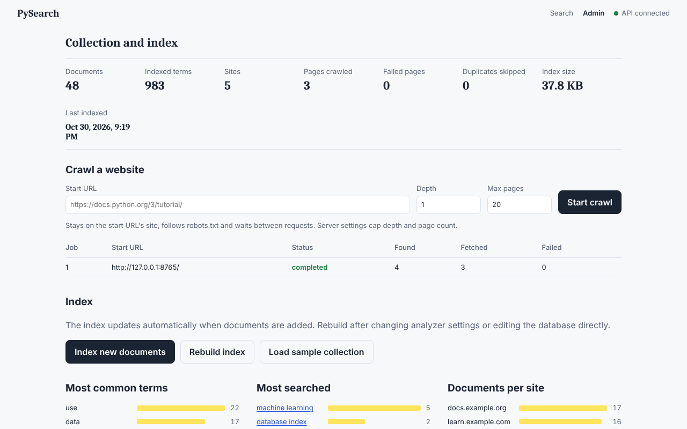

# PySearch: a private search engine built from scratch

PySearch crawls websites (or takes documents you paste), builds its own
inverted index, and ranks results with TF-IDF or BM25. You search it from a
React interface. Every search-engine component is written by hand in Python:
the tokenizer, Porter stemmer, inverted index, query parser, Boolean and
phrase retrieval, fuzzy matching, ranking, snippets and crawler.
**No Elasticsearch, no Whoosh, no NLTK, no external search or AI APIs.**
Everything runs on your computer.



## Features

**Search**
- Ranked retrieval with **BM25** or **TF-IDF**, switchable per query, with an
  "explain" view showing each term's tf, df, IDF and contribution
- **Boolean** `AND` / `OR` / `NOT` / `-word` / `( )`
- **Phrase search** `"machine learning"`, using word positions (stop-word
  gaps respected)
- **Field search** `title:`, `site:` (including subdomains), `author:`
- **Fuzzy search** `machne~` or typo-tolerant mode (Damerau–Levenshtein), plus
  "Did you mean"
- **Snippets** with highlighted matches, title highlighting, pagination
- **Autocomplete** from previous searches and indexed words
- **Search history** with click tracking; recent searches; clear history

**Indexing**
- HTML main-content extraction (drops scripts, menus, cookie banners,
  footers) and metadata (title, author, language, canonical URL)
- Text pipeline: cleaning, a Unicode-aware tokenizer (Kannada, Hindi and
  Tamil words stay whole; `C++`, `3.14` stay one token), normalization,
  stop words, and a hand-written **Porter stemmer** (identical to NLTK's on
  60,013 words)
- **Inverted index** (term → postings with tf and positions) and **forward
  index** (document → terms), title and body as separate fields
- Persisted in SQLite and loaded into memory at startup; documents are
  indexed incrementally as they are added, changed or deleted

**Crawler**
- Breadth-first, same-site, depth and page limits, one job at a time
- robots.txt (including Crawl-delay), `<meta robots>`, `rel=nofollow`
- Rate limiting, timeouts, retries with backoff, content-type filter, size cap
- **SSRF protection** (refuses private, loopback and cloud-metadata
  addresses, re-checked on every redirect)
- Duplicate detection by URL normalization, rel=canonical, and SHA-256 of
  the content

**Interface and tools**
- Search page, results page, document view (with forward-index top terms) and
  an **admin dashboard**:
  - statistics, crawl controls with live job status, index build/rebuild
  - charts of top terms, top queries and sites; add or delete documents
- `manage.py` command line: load sample, crawl, search, index, rebuild,
  stats, evaluate
- **Evaluation**: P@k, R@k, F1, MAP, MRR and nDCG on hand-labelled queries,
  comparing TF-IDF and BM25, plus a benchmark
- 44-document sample collection, 542 automated tests

## Architecture

```
 Seed URL ─► Crawler ─► HTML extractor ─► Analyzer ─► Indexer ─► SQLite (source of truth)
            (robots, limits,    (main text,      (tokenize, normalize,          │ loaded at startup
             SSRF guard)         metadata)        stop words, stem)             ▼
                                                                    in-memory inverted + forward index
 Query ─► Parser (AST) ─► Boolean/phrase retrieval ─► BM25 / TF-IDF ─► snippets ─► JSON ─► React UI
```

Details: [architecture](docs/architecture.md), [text processing](docs/text-processing.md),
[search](docs/search.md), [ranking](docs/ranking.md), [crawler](docs/crawler.md), [API](docs/api.md).

## Tech stack

| Layer | Choice |
|-------|--------|
| Backend | Python 3.12+, FastAPI, Uvicorn, Pydantic |
| Storage | SQLite through the built-in `sqlite3` module (versioned migrations, WAL mode) |
| HTML parsing | BeautifulSoup with Python's built-in `html.parser` |
| HTTP (crawler) | httpx2 |
| Frontend | React 18 + Vite 5, no UI or chart libraries, no external fonts |
| Tests | pytest + FastAPI TestClient |

Runtime dependencies: FastAPI, Uvicorn, Pydantic (+ pydantic-settings,
python-dotenv), BeautifulSoup and httpx2. Everything search-related is our own
code.

## Getting started (Windows, PowerShell)

Prerequisites: Python 3.12+ (`py --version`) and Node.js 18+ (`node --version`).

```powershell
# 1. Backend
cd backend
py -m venv .venv
.\.venv\Scripts\Activate.ps1
python -m pip install --upgrade pip
pip install -r requirements.txt
copy .env.example .env
python manage.py load-sample          # optional: 44 demo documents
uvicorn app.main:app --reload
```

```powershell
# 2. Frontend, in a second terminal
cd frontend
npm install
npm run dev
```

Open **http://localhost:5173**. The API documentation is at
http://127.0.0.1:8000/docs.

The frontend calls the API as `/api/...` on its own origin, and Vite's dev
proxy forwards those requests to `http://127.0.0.1:8000` (see
`frontend/vite.config.js`), so no cross-origin requests are needed. To call the
API directly instead, set `VITE_API_URL=http://127.0.0.1:8000` in
`frontend/.env`.

**Windows shortcuts:** double-click `scripts\restart-backend.bat` (stops any
old server, runs the tests, starts the backend) and
`scripts\start-frontend.bat` (installs packages if needed, starts Vite).

On macOS or Linux, use `python3 -m venv .venv`, `source .venv/bin/activate`
and `cp .env.example .env`.

> **Windows tip:** if the browser keeps showing old API behaviour after a
> restart, an orphaned uvicorn process may still be holding port 8000. Run
> `scripts\restart-backend.bat`: it stops orphaned servers on port 8000,
> runs the tests and starts a fresh server.

## Using it

**Search** from the home page. Try:

```
machine learning                 ranked, any of the words
"virtual memory" OR paging       phrase OR word
python NOT java                  exclusion
title:python site:docs.example.org
author:girish
backpropogation                  -> "Did you mean: backpropagation"
machne~                          fuzzy
```

**Crawl a site:** *Admin → Crawl a website*, or

```powershell
python manage.py crawl --url https://docs.python.org/3/tutorial/ --depth 1 --max-pages 20
```

**Add your own document:** *Admin → Add a document* (plain text or HTML), or
`POST /documents`.

**Command line** (from `backend/`):

```powershell
python manage.py search "binary search" --explain
python manage.py stats
python manage.py rebuild
python manage.py evaluate
```

The server keeps the index in memory. After changing data with `manage.py`
while the server is running, click *Rebuild index* in the admin page, or
restart the server.

## Configuration (`backend/.env`)

| Setting | Default | Meaning |
|---------|---------|---------|
| `DATABASE_PATH` | `data/pysearch.db` | SQLite file (relative to the project root) |
| `CORS_ORIGINS` | `http://localhost:5173,...` | Frontend origins allowed to call the API |
| `MAX_PAGES` / `MAX_DEPTH` | 50 / 2 | Upper limits for any crawl job |
| `REQUEST_DELAY` / `REQUEST_TIMEOUT` | 1.0 s / 10 s | Politeness delay per host, per-request timeout |
| `MAX_RETRIES` | 2 | Retries for timeouts, 429 and 5xx |
| `ALLOWED_DOMAINS` | empty | Extra domains crawls may follow |
| `RESPECT_ROBOTS_TXT` | true | Obey robots.txt |
| `ALLOW_PRIVATE_NETWORKS` | false | Allow crawling localhost/LAN (turns off SSRF protection) |

## Database schema (v3)

| Table | Contents |
|-------|----------|
| `documents` | url, canonical_url (unique), title, content, author, domain, language, content_type, http_status, content_hash, crawl_job_id |
| `crawl_jobs` | seed URL, status (pending → running → completed/failed/cancelled), limits, counters, error |
| `urls` | crawl state per normalized URL: status, HTTP status, attempts, last error, next crawl time, document |
| `terms` | (field, term) → id, document frequency |
| `postings` | (term, document) → tf, positions (packed 32-bit ints) |
| `doc_stats` | document lengths (for BM25), content hash at indexing time |
| `vocabulary` | real word → stem (fuzzy matching, autocomplete) |
| `search_history` | query, mode, ranker, result count, latency, clicked document |
| `index_meta`, `schema_info` | last indexing time, analyzer settings, schema version |

Migrations run automatically at startup, and an existing database is backed
up before every upgrade. See [architecture.md](docs/architecture.md).

## Testing

```powershell
cd backend
python -m pytest                    # 542 tests
python -m pytest tests/test_search_engine.py -v
python manage.py evaluate           # TF-IDF vs BM25 + benchmark
```

The tests cover the text pipeline, Porter (4,082 reference pairs), the index
(persistence, atomicity, re-indexing), the parser, Boolean, phrase, field and
fuzzy search, ranking formulas checked against hand-computed values,
snippets, autocomplete, the crawler (against a fake website: robots, SSRF,
redirects, retries, duplicates, cancellation), every API endpoint,
migrations, and the CLI.

### Evaluation result

| Metric | TF-IDF | BM25 |
|--------|--------|------|
| MAP | 0.943 | **0.979** |
| MRR | 0.975 | **1.000** |
| nDCG@10 | 0.966 | **0.990** |

BM25 wins mainly by demoting a long, repetitive glossary page that TF-IDF puts
second for 8 of 20 queries. The test set is small and self-labelled: see
[ranking.md](docs/ranking.md) for an honest discussion.

## Project structure

```
backend/
  app/
    api/          FastAPI routes: search, documents, index, crawler, analyze, health
    crawler/      fetcher, robots.txt, SSRF guard, link parser, queue, jobs
    database/     sqlite3 connection, migrations, models, repositories
    evaluation/   IR metrics, TF-IDF vs BM25 evaluation, benchmark
    indexing/     HTML extractor, cleaner, tokenizer, normalizer, stop words,
                  Porter stemmer, analyzer, inverted/forward index, indexer
    ranking/      tfidf.py, bm25.py, ranker.py
    search/       query parser, search engine, fuzzy, snippets, suggestions
    services/     documents, crawl state, ingestion, history, statistics, sample data
    utils/        URL normalization
  tests/          542 tests
  manage.py       command-line tool
frontend/src/     React app: pages (home, results, document, admin) and components
data/sample/      demo collection     data/eval/  labelled queries
docs/             architecture, text processing, search, ranking, crawler, API
scripts/          inspect_db.py, restart-backend.bat/.ps1, start-frontend.bat (Windows)
```

## Known limitations

- The whole index lives in memory. That's fine for thousands of documents
  but not millions; a disk-based index would be needed for more.
- Pages rendered by JavaScript (single-page apps) yield little text.
- Chinese and Japanese text isn't segmented into words. Stemming and stop
  words are English only.
- The crawler's SSRF check is vulnerable to DNS rebinding (see
  [crawler.md](docs/crawler.md)). There is no user authentication: this is a
  single-user local tool, so keep the API bound to 127.0.0.1.
- The evaluation set is small (20 queries) and self-labelled.

## Screenshots

| Home | Admin |
|------|-------|
|  |  |

## License

[MIT](LICENSE)
